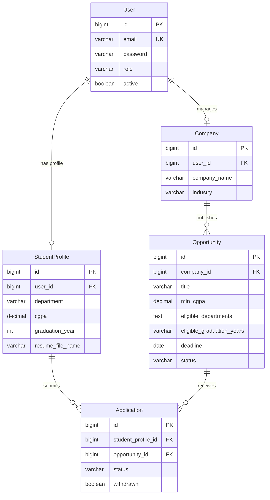

# SkillMatch — Centralized Placement & Internship Management System

SkillMatch is a full-stack, enterprise-grade college placement and internship management web application. It connects college students, corporate recruiters, and college placement administrators on a centralized platform with criteria-driven eligibility checking, secure PDF resume storage, and recruitment workflow tracking.

---

## 1. Project Technology Stack

- **Frontend**: HTML5, CSS3 (Modern Purple & White design system with glassmorphism, responsive cards, accessibility focus states), Vanilla JavaScript ES6+.
- **Backend**: Java 21, Spring Boot 3.3.4, Spring MVC (RESTful JSON APIs).
- **Security**: Spring Security 6 with session-based authentication, BCrypt password hashing, and CSRF token protection (`CookieCsrfTokenRepository`).
- **ORM / Persistence**: Spring Data JPA, Hibernate 6.
- **Database**: MySQL 8.x (production), H2 in-memory/file mode (isolated automated testing and offline dev profile).
- **Build Tool**: Apache Maven (`pom.xml`, Windows `mvnw.cmd` wrapper included).
- **Testing**: JUnit 5, Spring Boot Test, Spring Security Test, MockMvc (13 test methods covering all 15 core scenarios).

---

## 2. Architecture & Package Structure

The backend follows standard Spring Boot layered architecture:

```
src/main/java/com/skillmatch/
├── SkillMatchApplication.java       # Application entry point
├── config/
│   └── DataInitializer.java        # Auto-bootstraps admin, companies, students & opportunities
├── controller/
│   ├── AdminController.java         # Placement statistics, user controls, company onboarding
│   ├── ApplicationController.java   # Application submission, status transitions, withdrawal
│   ├── AuthController.java          # Login, student registration, session state, CSRF
│   ├── CompanyController.java       # Recruiter profile, company opportunities, applicant review
│   ├── OpportunityController.java   # Public search, filters, details, and CRUD
│   ├── ResumeController.java        # Protected PDF resume streaming with ownership verification
│   └── StudentController.java       # Profile updates, resume uploads, application tracking
├── dto/                             # Request and response models concealing entity internals
├── entity/
│   ├── Application.java             # Linked student-opportunity pair with status & unique constraint
│   ├── Company.java                 # Recruiter company details
│   ├── Opportunity.java             # Jobs and internships with eligibility criteria
│   ├── StudentProfile.java          # Academic credentials, CGPA, department, graduation year
│   └── User.java                    # Base authentication account
├── enums/
│   ├── ApplicationStatus.java       # Workflow states and allowed transition rules
│   ├── OpportunityStatus.java       # PUBLISHED, DRAFT, CLOSED
│   ├── OpportunityType.java         # FULL_TIME, INTERNSHIP, PART_TIME
│   ├── Role.java                    # ROLE_STUDENT, ROLE_COMPANY, ROLE_ADMIN
│   └── WorkplaceType.java           # ON_SITE, HYBRID, REMOTE
├── exception/
│   ├── GlobalExceptionHandler.java  # Centralized JSON error format handler
│   ├── IneligibleApplicationException.java
│   ├── DuplicateResourceException.java
│   └── ...
├── repository/                      # Spring Data JPA repositories with query methods
├── security/
│   ├── CustomUserDetails.java
│   ├── CustomUserDetailsService.java
│   ├── CsrfCookieFilter.java
│   └── SecurityConfig.java          # Security filter chain and endpoint permissions
└── service/
    ├── AdminService.java
    ├── ApplicationService.java
    ├── AuthService.java
    ├── CompanyService.java
    ├── EligibilityService.java      # Criteria evaluation engine
    ├── OpportunityService.java
    ├── ResumeStorageService.java    # Magic-byte check and path traversal defense
    └── StudentService.java
```

---

## 3. Database Design & Setup

The database is named `skillmatch`.

### MySQL Database Setup

1. Log in to your MySQL 8.x CLI or MySQL Workbench:
   ```bash
   mysql -u root -p
   ```
2. Create database and tables using the provided script:
   ```sql
   CREATE DATABASE IF NOT EXISTS skillmatch CHARACTER SET utf8mb4 COLLATE utf8mb4_unicode_ci;
   USE skillmatch;
   ```
   Or execute the complete DDL script:
   ```bash
   mysql -u root -p skillmatch < scripts/schema.sql
   ```
3. (Optional) Import sample seed data:
   ```bash
   mysql -u root -p skillmatch < scripts/seed.sql
   ```
   *Note*: When starting the Spring Boot backend on a fresh database, `DataInitializer` will automatically bootstrap demo records if the database is empty.

### Entities and Relationships



---

## 4. Environment Variables & Configuration

The application reads database configuration from environment variables with safe development defaults:

| Variable | Description | Default |
|---|---|---|
| `DB_URL` | MySQL JDBC connection URL | `jdbc:mysql://localhost:3306/skillmatch?createDatabaseIfNotExist=true&useSSL=false&allowPublicKeyRetrieval=true&serverTimezone=UTC` |
| `DB_USERNAME` | MySQL database user | `root` |
| `DB_PASSWORD` | MySQL database password | `(empty)` |
| `UPLOAD_DIR` | Server directory for resume PDFs | `uploads/resumes` |

Configuration files provided:
- `src/main/resources/application.properties`: Primary configuration for MySQL.
- `src/main/resources/application.properties.example`: Configuration template.
- `src/main/resources/application-dev-h2.properties`: Fallback in-memory profile for offline development.
- `src/test/resources/application.properties`: Test profile using isolated in-memory H2 database.

---

## 5. Pre-Seeded Demo Accounts

The system includes pre-seeded demo accounts for quick testing:

| Role | Email | Password | Description |
|---|---|---|---|
| **Administrator** | `admin@skillmatch.edu` | `Admin@123` | Institutional placement director |
| **Recruiter (TechCorp)** | `recruiter@techcorp.com` | `Password@123` | Corporate recruiter at TechCorp Solutions |
| **Recruiter (CloudScale)** | `hr@cloudscale.io` | `Password@123` | Recruiter at CloudScale Systems |
| **Student (Arun Kumar)** | `arun.kumar@student.edu` | `Password@123` | CS 2025 graduate (CGPA: 8.75) |
| **Student (Priya Sharma)** | `priya.sharma@student.edu` | `Password@123` | IT 2025 graduate (CGPA: 9.10) |

*(Note: The login page includes 1-click autofill buttons for these credentials).*

---

## 6. Windows Step-by-Step Execution Guide

### Prerequisites Check

Open PowerShell or Command Prompt in the project folder:

```powershell
# 1. Verify Java (Version 21 or higher)
java -version

# 2. Verify Maven or use the included Windows wrapper (mvnw.cmd)
.\mvnw.cmd -version
```

### Option A: Running with MySQL (Standard Production Mode)

1. Make sure your MySQL service is started:
   ```powershell
   Get-Service -Name "*mysql*" | Start-Service
   ```
2. Create the database:
   ```sql
   CREATE DATABASE IF NOT EXISTS skillmatch;
   ```
3. Set your MySQL credentials (if not using defaults):
   ```powershell
   $env:DB_USERNAME="root"
   $env:DB_PASSWORD="your_password"
   ```
4. Build and start the Spring Boot application:
   ```powershell
   .\mvnw.cmd spring-boot:run
   ```

### Option B: Running with In-Memory Database (Quick Preview Mode)

If you don't have MySQL installed on your system yet, run the offline developer profile:

```powershell
.\mvnw.cmd spring-boot:run "-Dspring-boot.run.profiles=dev-h2"
```

Or run the packaged JAR directly:

```powershell
java "-Dspring.profiles.active=dev-h2" -jar target\skillmatch-1.0.0.jar
```

### Accessing the Application

Open your browser to:
- **Application URL**: [http://localhost:8080](http://localhost:8080)
- **Browse Opportunities**: [http://localhost:8080/opportunities.html](http://localhost:8080/opportunities.html)
- **Login Portal**: [http://localhost:8080/login.html](http://localhost:8080/login.html)
- **H2 Console (if using dev profile)**: [http://localhost:8080/h2-console](http://localhost:8080/h2-console) (JDBC URL: `jdbc:h2:file:./data/skillmatch_h2`, User: `sa`, Password: `(empty)`)

---

## 7. Running Automated Tests

Run the full automated test suite:

```powershell
.\mvnw.cmd clean test
```

### Test Coverage Summary

The automated test suite verifies all required test cases:

| Test Class | Test Scenarios Verified | Status |
|---|---|---|
| `StudentRegistrationAndAuthTest` | 1. Student registration with password hashing<br>2. Login with valid/invalid credentials<br>3. Unauthorized endpoint access protection<br>4. Role-based endpoint boundaries | **PASSED** (4 tests) |
| `StudentProfileAndResumeTest` | 5. Student profile retrieval and updates<br>14. Resume upload validation (PDF magic bytes `%PDF`) and access control | **PASSED** (2 tests) |
| `OpportunityManagementAndSearchTest` | 6. Opportunity creation & company ownership isolation<br>7. Public search, filtering, and sorting | **PASSED** (2 tests) |
| `EligibilityAndApplicationWorkflowTest` | 8. Backend eligibility evaluation engine<br>9. Application submission<br>10. Duplicate application rejection (409 Conflict)<br>11. Application deadline enforcement<br>12. Application status transitions<br>13. Unauthorized applicant access prevention | **PASSED** (4 tests) |
| `AdminManagementIntegrationTest` | 15. Administrator dashboard, user status toggle, and company onboarding | **PASSED** (1 test) |

**Total:** 13 test methods, 15 scenarios, **0 Failures, 0 Errors**.

---

## 8. REST API Documentation

### Authentication Endpoints
- `POST /api/auth/register/student`: Register student account.
- `POST /api/auth/login`: Authenticate and start session.
- `POST /api/auth/logout`: Invalidate session.
- `GET /api/auth/me`: Retrieve current logged-in user details.
- `GET /api/auth/csrf`: Retrieve active CSRF token.

### Student Endpoints (`ROLE_STUDENT`)
- `GET /api/students/me`: View student academic profile.
- `PUT /api/students/me`: Update profile details.
- `POST /api/students/me/resume`: Upload PDF resume (max 5MB, magic byte checked).
- `GET /api/students/me/applications`: List submitted applications.
- `GET /api/students/me/dashboard`: Student metric cards.

### Opportunities Endpoints
- `GET /api/opportunities`: Search & filter opportunities (Query, type, department, location, sort).
- `GET /api/opportunities/{id}`: Detailed opportunity requirements.
- `GET /api/opportunities/{id}/eligibility`: Evaluate logged-in student's eligibility with reasons.
- `POST /api/opportunities`: Create opportunity (`ROLE_COMPANY`).
- `PUT /api/opportunities/{id}`: Update opportunity (Company owner or Admin).
- `PATCH /api/opportunities/{id}/publish`: Publish opportunity.
- `PATCH /api/opportunities/{id}/close`: Close opportunity.
- `DELETE /api/opportunities/{id}`: Delete opportunity.

### Application Workflow Endpoints
- `POST /api/opportunities/{id}/applications`: Submit application (`ROLE_STUDENT`). Enforces eligibility and blocks duplicates.
- `GET /api/applications/me`: Current student's applications.
- `GET /api/applications/{id}`: View specific application details (Authorized student, recruiter, or admin).
- `PATCH /api/applications/{id}/status`: Transition candidate status (`UNDER_REVIEW`, `SHORTLISTED`, `INTERVIEW_SCHEDULED`, `SELECTED`, `REJECTED`).
- `POST /api/applications/{id}/withdraw`: Withdraw application (Allowed prior to final decision).

### Company Endpoints (`ROLE_COMPANY`)
- `GET /api/companies/me`: Company profile.
- `PUT /api/companies/me`: Update company details.
- `GET /api/companies/me/opportunities`: List company-owned opportunities.
- `GET /api/companies/me/opportunities/{id}/applicants`: List applicants for opportunity.
- `GET /api/companies/me/applicants`: All applicants for this company.
- `GET /api/companies/me/dashboard`: Recruiter metric cards.

### Administrator Endpoints (`ROLE_ADMIN`)
- `GET /api/admin/dashboard`: Aggregate placement metrics & status distribution.
- `GET /api/admin/users`: List all users.
- `PATCH /api/admin/users/{id}/status`: Activate or deactivate user account.
- `POST /api/admin/companies`: Onboard approved corporate recruiter.
- `GET /api/admin/opportunities`: Audit all institutional opportunities.
- `GET /api/admin/applications`: Audit all campus applications.

### Resume Access
- `GET /api/resumes/{filename}`: Stream PDF resume. Strict authorization: accessible only by the student owner, recruiters reviewing an application from that student, or system administrators.

---

## 9. Troubleshooting & Common Issues

1. **Port 8080 already in use**:
   - Check which process is using the port: `netstat -ano | findstr :8080`
   - Or change port in `src/main/resources/application.properties`: `server.port=8081`
2. **Access Denied / 403 on API Requests**:
   - SkillMatch enforces Spring Security CSRF tokens for state-changing requests (`POST`, `PUT`, `PATCH`, `DELETE`). The frontend `api.js` client automatically reads the `XSRF-TOKEN` cookie and attaches the `X-XSRF-TOKEN` header.
3. **Database connection failure**:
   - Ensure MySQL service is running: `Get-Service -Name "*mysql*"`.
   - Ensure the database exists: `CREATE DATABASE IF NOT EXISTS skillmatch;`.
   - Alternatively, test immediately using the offline profile: `.\mvnw.cmd spring-boot:run "-Dspring-boot.run.profiles=dev-h2"`.
